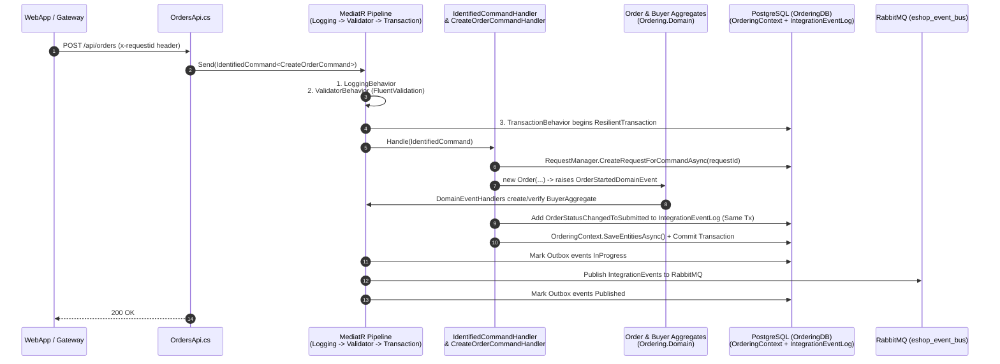
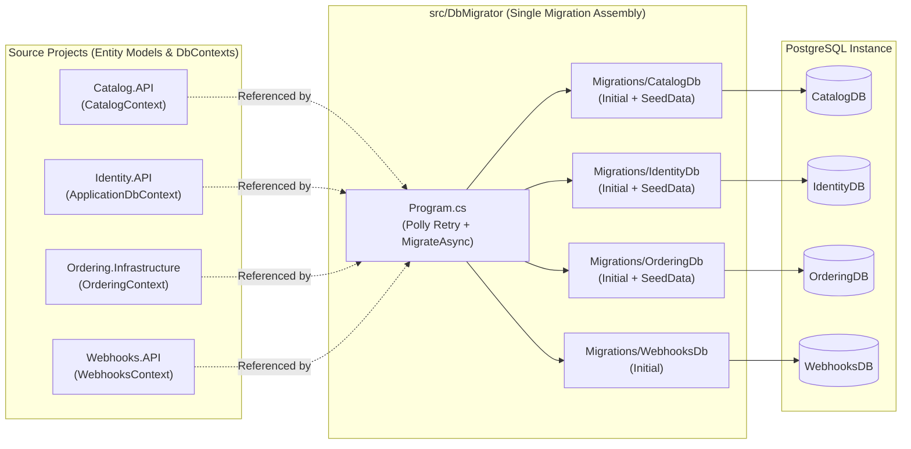
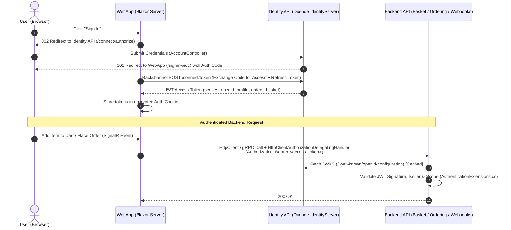

# ARCHITECTURE.md — eShop System Architecture & Design Guide

> **Purpose:** Comprehensive technical reference covering system topology, communication protocols, architectural patterns (DDD, CQRS, Transactional Outbox, Event-Driven Saga), data storage, security flows, and the hybrid Local (.NET Aspire) / Cloud (AWS ECS) runtime model.
> For fast file-path lookups and CLI commands, see [`AGENTS.md`](AGENTS.md). For AWS migration tasks, see [`plans/aws-migration-plan.md`](plans/aws-migration-plan.md).

---

## 1. Architectural Overview & Core Principles

The **eShop** application is a distributed, cloud-native e-commerce system built on **.NET 10**. Rather than applying a single one-size-fits-all pattern across all services, each microservice uses an architectural style matched to its domain complexity:

| Architectural Pattern | Applied In | Rationale |
| :--- | :--- | :--- |
| **DDD + CQRS + Clean Architecture** | `Ordering.API`, `Ordering.Domain`, `Ordering.Infrastructure` | High business complexity: order lifecycle state machine, invariants, buyer verification, idempotency, and domain events. |
| **Vertical Slice / Minimal API + EF Core** | `Catalog.API`, `Webhooks.API` | CRUD and query-heavy workloads with low domain branching; direct `DbContext` usage inside typed Minimal API handlers. |
| **High-Performance RPC + Key-Value Store** | `Basket.API` | Ephemeral, high-throughput shopping cart operations exposed over **HTTP/2 gRPC** and backed by **Redis**. |
| **Token Server (OIDC / OAuth 2.0)** | `Identity.API` | Centralized authentication and token issuance using **ASP.NET Core Identity** + **Duende IdentityServer**. |
| **Event-Driven Background Workers** | `OrderProcessor`, `PaymentProcessor` | Autonomous background services (`BackgroundService`) that poll state or react to integration events asynchronously. |
| **Reverse Proxy / BFF Gateway** | `eShop.Gateway` | Unified **YARP** ingress routing HTTP/1.1 REST and HTTP/2 gRPC traffic to downstream backend APIs. |
| **Server-Rendered Interactive UI** | `WebApp`, `WebAppComponents` | **Blazor Web App (Interactive Server)** maintaining stateful SignalR circuits and communicating with backend services over HTTP/gRPC and RabbitMQ. |

---

## 2. System Topology & Communication Matrix

### 2.1 End-to-End Architecture Diagram

```mermaid
flowchart TB
    subgraph Clients["Client Layer"]
        Browser["Web Browser"]
        Mobile["MAUI Mobile / Desktop<br/>(ClientApp / HybridApp)"]
        ExtHook["External Webhook Receiver<br/>(WebhookClient)"]
    end

    subgraph Edge["Ingress & Presentation Layer"]
        WebApp["WebApp<br/>(Blazor Interactive Server)"]
        Gateway["eShop.Gateway<br/>(YARP Reverse Proxy / BFF)"]
        Identity["Identity.API<br/>(Duende IdentityServer OIDC)"]
    end

    subgraph CoreAPIs["Core Microservices Layer"]
        Basket["Basket.API<br/>(gRPC Server)"]
        Catalog["Catalog.API<br/>(Minimal API + pgvector)"]
        Ordering["Ordering.API<br/>(Minimal API + MediatR CQRS)"]
        Webhooks["Webhooks.API<br/>(Minimal API)"]
    end

    subgraph Workers["Background Workers"]
        OrderProc["OrderProcessor<br/>(Grace Period Polling)"]
        PayProc["PaymentProcessor<br/>(Simulated Payment Handler)"]
        Migrator["DbMigrator<br/>(One-Off EF Core Migration Runner)"]
    end

    subgraph Data["Data & Messaging Infrastructure"]
        Redis[("Redis<br/>(Basket Store)")]
        Rabbit[["RabbitMQ<br/>(Topic Exchange: eshop_event_bus)"]]
        PG[("PostgreSQL + pgvector<br/>(CatalogDB | OrderingDB | IdentityDB | WebhooksDB)")]
    end

    Browser -->|"HTTPS + WebSockets (/_blazor)"| WebApp
    Browser -->|"HTTPS (OIDC Login)"| Identity
    Mobile -->|"HTTPS REST / gRPC"| Gateway
    Mobile -->|"HTTPS OIDC"| Identity

    WebApp -->|"gRPC (HTTP/2)"| Basket
    WebApp -->|"REST (HTTP/1.1)"| Catalog
    WebApp -->|"REST (HTTP/1.1)"| Ordering
    WebApp -->|"OIDC Backchannel"| Identity

    Gateway -->|"REST /api/catalog/*"| Catalog
    Gateway -->|"REST /api/orders/*"| Ordering
    Gateway -->|"gRPC & REST"| Basket
    Gateway -->|"REST /api/webhooks/*"| Webhooks

    Basket --> Redis
    Catalog & Ordering & Identity & Webhooks & OrderProc & Migrator --> PG

    Catalog & Basket & Ordering & Webhooks & OrderProc & PayProc & WebApp <-->|"AMQP 0-9-1 Pub/Sub"| Rabbit
    Webhooks -->|"Outbound HTTP POST"| ExtHook
```

### 2.2 Service Communication & Protocol Matrix

| Service | Inbound Protocol | Outbound Synchronous Calls | Database / State Store | Messaging Role (RabbitMQ) |
| :--- | :--- | :--- | :--- | :--- |
| **`eShop.Gateway`** | HTTP/1.1 & HTTP/2 | Proxies to `Catalog`, `Ordering`, `Basket`, `Webhooks` | Stateless *(Redis Cache planned)* | None |
| **`WebApp`** | HTTPS + SignalR WebSockets | `Catalog.API` (REST), `Ordering.API` (REST), `Basket.API` (gRPC), `Identity.API` (OIDC) | In-memory circuit state | Subscribes to `OrderStatusChangedTo*` |
| **`Identity.API`** | HTTP/1.1 (MVC + OIDC endpoints) | Redirects to registered client callbacks | PostgreSQL (`IdentityDB`) | None |
| **`Catalog.API`** | HTTP/1.1 REST (`/api/catalog`) | Optional AI Embeddings (`ICatalogAI`) | PostgreSQL (`CatalogDB` + `pgvector`) | Publishes via Outbox; Subscribes to Order status events |
| **`Basket.API`** | HTTP/2 gRPC (`BasketApi.Basket`) | `Identity.API` (JWT validation) | Redis (`/basket/{userId}`) | Subscribes to `OrderStartedIntegrationEvent` |
| **`Ordering.API`** | HTTP/1.1 REST (`/api/orders`) | `Identity.API` (JWT validation) | PostgreSQL (`OrderingDB`, schema `ordering`) | Publishes via Outbox; Subscribes to GracePeriod, Stock, Payment events |
| **`OrderProcessor`** | None (Worker) | None | PostgreSQL (`OrderingDB` read-only polling) | Publishes `GracePeriodConfirmedIntegrationEvent` |
| **`PaymentProcessor`** | None (Worker) | None | Stateless | Subscribes to StockConfirmed; Publishes Payment Succeeded/Failed |
| **`Webhooks.API`** | HTTP/1.1 REST (`/api/webhooks`) | Outbound HTTP `POST` to subscriber URLs | PostgreSQL (`WebhooksDB`) | Subscribes to Paid, Shipped, PriceChanged events |
| **`DbMigrator`** | None (CLI / Job) | None | PostgreSQL (All 4 DBs) | None |

---

## 3. Deep Dive: Key Subsystem Architectures

### 3.1 Ordering Subsystem (DDD, CQRS, MediatR Pipeline & Transactional Outbox)

`Ordering` is split into three projects enforcing strict dependency direction:
`Ordering.API` $\rightarrow$ `Ordering.Infrastructure` $\rightarrow$ `Ordering.Domain`

* **Idempotency (`IdentifiedCommand`):** Every mutating request requires an `x-requestid` GUID header. `RequestManager` inserts a record into `ordering.requests` inside the transaction; duplicate request IDs short-circuit safely.
* **Domain Events vs. Integration Events:**
  * **Domain Events** (`INotification` via MediatR) run **in-process and within the same database transaction** before `SaveChangesAsync` completes (see `MediatorExtension.DispatchDomainEventsAsync` in `Ordering.Infrastructure/MediatorExtension.cs`). For example, `OrderStartedDomainEvent` triggers `ValidateOrAddBuyerAggregateWhenOrderStartedDomainEventHandler` to ensure the `Buyer` and `PaymentMethod` exist before the order is committed.
  * **Integration Events** (`IntegrationEvent`) cross microservice boundaries via RabbitMQ. They are first persisted into the `IntegrationEventLog` table inside the exact same PostgreSQL transaction (`ResilientTransaction`), and only published to RabbitMQ after the database transaction commits (`TransactionBehavior.cs`).

---

### 3.2 EventBus & Transactional Outbox Pattern

* **Abstraction (`src/EventBus`):** Defines `IEventBus`, `IntegrationEvent`, and `IIntegrationEventHandler<T>`. Event types are registered at startup using `.AddSubscription<TEvent, THandler>()` and serialized using `System.Text.Json` source generation (`EventBusSubscriptionInfo.JsonSerializerOptions`) for AOT/trimming compatibility.
* **Transport (`src/EventBusRabbitMQ`):**
  * `RabbitMQEventBus` connects to RabbitMQ, declares a `direct`/`topic` exchange named `eshop_event_bus`, and creates a consumer queue named after each service's `SubscriptionClientName` (e.g., `Catalog`, `Basket`, `Ordering`, `PaymentProcessor`, `Webhooks`, `WebApp`).
  * Routing keys match the C# class name of the event (e.g., `OrderStatusChangedToAwaitingValidationIntegrationEvent`).
  * Propagates OpenTelemetry `traceparent` / `tracestate` headers inside RabbitMQ `BasicProperties.Headers` (`RabbitMQTelemetry`) so distributed traces connect seamlessly across HTTP and AMQP hops.
* **Outbox (`src/IntegrationEventLogEF`):**
  * Stores `EventId`, `EventTypeName`, `Content` (JSON), `State` (`NotPublished = 0`, `InProgress = 1`, `Published = 2`, `PublishedFailed = 3`), `TimesSent`, and `TransactionId` in the `IntegrationEventLog` table of `CatalogDB` and `OrderingDB`.

---

### 3.3 Catalog & AI Semantic Search (`pgvector`)

* **API Versioning:** Uses `Asp.Versioning.Http` to expose v1.0 and v2.0 routes under `/api/catalog` (`src/Catalog.API/Apis/CatalogApi.cs`).
* **Vector Search (`src/Catalog.API/Services/CatalogAI.cs`):**
  * Each `CatalogItem` has a `Pgvector.Vector? Embedding` property mapped to PostgreSQL column `vector(384)`.
  * When an `IEmbeddingGenerator<string, Embedding<float>>` is registered (via Microsoft Foundry `text-embedding-3-small` or Ollama `all-minilm`), `CatalogAI` converts search queries into 384-dimension float vectors.
  * Semantic search queries PostgreSQL using cosine distance (`i.Embedding!.CosineDistance(vector)`) ordered by relevance.

---

### 3.4 Database & Centralized Migration Architecture (`src/DbMigrator`)

To support zero-downtime cloud deployments and least-privilege database credentials in production:

* **Zero Startup DDL in APIs:** None of the API services execute `MigrateAsync()` or runtime C# seeders on startup.
* **Immutable SQL Seed Migrations:** Reference data (Catalog brands/types/items, Ordering card types, Identity initial users) is versioned inside EF Core `SeedData` migrations using idempotent PostgreSQL statements (`INSERT ... ON CONFLICT DO NOTHING` and `setval(...)`).

---

### 3.5 Authentication, Authorization & Token Forwarding

* **Backend Token Validation (`src/eShop.ServiceDefaults/AuthenticationExtensions.cs`):**
  Every protected microservice calls `builder.AddDefaultAuthentication()`, which configures `JwtBearer` authentication against the `Identity` section in configuration (`Identity:Url` and `Authentication:Schemes:Bearer:ValidAudiences`).
* **Token Forwarding (`src/eShop.ServiceDefaults/HttpClientExtensions.cs`):**
  `WebApp` registers `.AddAuthToken()` on outgoing `HttpClient` and gRPC client builders. `HttpClientAuthorizationDelegatingHandler` extracts the `access_token` from the current `HttpContext` and attaches it as a `Bearer` header.

---

### 3.6 Cross-Cutting Concerns (`src/eShop.ServiceDefaults`)

Every service calls `builder.AddServiceDefaults()` and `app.MapDefaultEndpoints()`:
1. **OpenTelemetry:** Configures logging, metrics (`AspNetCore`, `HttpClient`, `Runtime`, `Experimental.Microsoft.Extensions.AI`), and distributed tracing (`AspNetCore`, `HttpClient`, `GrpcClient`, `EventBus`, `Experimental.Microsoft.Extensions.AI`), exporting via OTLP when `OTEL_EXPORTER_OTLP_ENDPOINT` is set.
2. **Service Discovery & Resiliency:** Enables `Microsoft.Extensions.ServiceDiscovery` and attaches `AddStandardResilienceHandler` (Polly retry, circuit breaker, timeout, rate limiter) to all `HttpClient` instances by default.
3. **Health Probes:**
   * `/alive`: Liveness check (verifies the process is responsive, tagged `"live"`).
   * `/health`: Readiness check (verifies downstream dependencies like PostgreSQL, Redis, and RabbitMQ are reachable).

---

## 4. Hybrid Runtime Model: Local (.NET Aspire) vs. Cloud (AWS)

The repository is architected to run seamlessly in two environments without changing domain or business logic:

| Concern | Local Development (`eShop.AppHost`) | Production Cloud (AWS Target Architecture) |
| :--- | :--- | :--- |
| **Orchestrator** | `.NET Aspire` (`aspire run`) | **Amazon ECS on AWS Fargate** (`linux/arm64` Graviton) |
| **Service Discovery** | Aspire environment variables (`services__catalog-api__http__0`) | **AWS ECS Service Connect** (`http://<service>.eshop.local:8080`) |
| **North-South Ingress** | Direct localhost ports / Aspire Dashboard | **Amazon CloudFront + Public ALB** (WebApp/Identity) & **Amazon API Gateway v2 + VPC Link** (`eShop.Gateway`) |
| **East-West API Routing** | Direct service references or `eShop.Gateway` | **`eShop.Gateway` (YARP BFF)** with Redis OutputCache & Rate Limiting |
| **Databases** | Single `ankane/pgvector` Docker container | **Amazon RDS for PostgreSQL Multi-AZ** (4 logical DBs + `pgvector` HNSW index) |
| **Migration Execution** | `db-migrator` project resource in `AppHost.cs` | One-off ECS Fargate Task (`aws ecs run-task`) in CI/CD before service rollout |
| **Cache & Session State** | Local Redis container | **Amazon ElastiCache for Redis** (Basket + ASP.NET DataProtection keys + OutputCache) |
| **Event Broker** | Local RabbitMQ container | **Amazon MQ for RabbitMQ** (with Dead-Letter Queues `*_dlq`) |
| **Static Assets (`Pics/`)** | Served from `Catalog.API` container disk via YARP forwarder | Offloaded to **Amazon S3 + CloudFront CDN** via `ProductImageUrlProvider` |
| **Observability** | Aspire Dashboard | **AWS Distro for OpenTelemetry (ADOT)** $\rightarrow$ CloudWatch Logs & AWS X-Ray |
