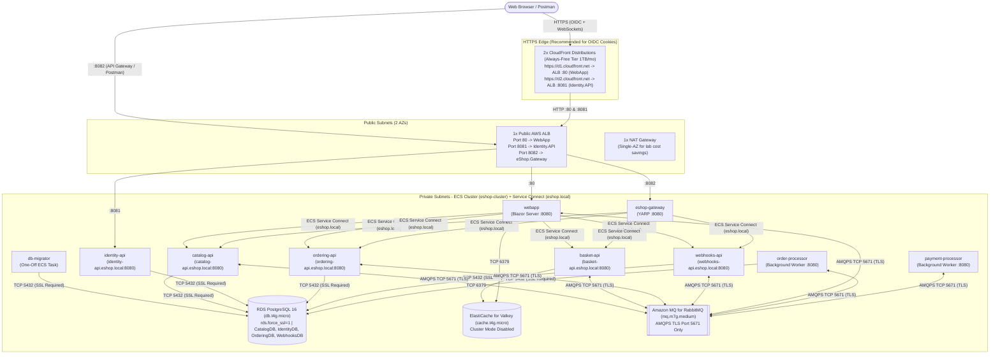

# AWS Console Hands-On Deployment Playbook (ClickOps Before IaC)

> **Objective:** Deploy the full **.NET 10 eShop** microservices solution onto AWS manually via the **AWS Management Console** using a lean, cost-aware architecture. This lets you validate every network path, environment variable, TLS/OIDC redirect, and container interaction hands-on before codifying the infrastructure into Terraform or AWS CDK.

---

## 1. Recommended Hands-On Architecture (Lean & AWS-Accurate)

When deploying manually via the AWS Console for the first time, setting up API Gateway v2 + VPC Link + S3 OAC + Secrets Manager all at once introduces too many moving parts to debug. The architecture below preserves **100% of the microservice and event-driven topology** while streamlining ingress and AWS service choices to match real AWS behavior:



### Key AWS Design Decisions & Cost Realities
1. **Single Public ALB with Multi-Port Listeners:**
   * Both `WebApp` and `Identity.API` expect to run at the root path `/` (mounting `Identity.API` under `/identity` breaks OIDC discovery and static assets).
   * Instead of provisioning 3 ALBs (3x hourly cost), create **1 Public ALB** with 3 listeners (`:80` $\rightarrow$ `WebApp`, `:8081` $\rightarrow$ `Identity.API`, `:8082` $\rightarrow$ `eShop.Gateway`).
2. **Handling OIDC Browser Cookies (`https://` via CloudFront vs. HTTP Lab Workaround):**
   * **Important Browser Security Rule:** ASP.NET Core `AddOpenIdConnect` sets `CorrelationCookie` and `NonceCookie` with `SameSite=None`. Modern browsers (Chrome/Edge/Safari) **reject `SameSite=None` cookies over plain `http://` on non-localhost domains** (`*.elb.amazonaws.com`), causing a `Correlation failed` error on login!
   * **Recommended AWS Fix (Zero Domain Purchase Needed):** Put **Amazon CloudFront** (Always-Free Tier: 1 TB/month + 10M requests/month, supports WebSockets for Blazor `/_blazor`) in front of your ALB ports `:80` and `:8081` to get free `https://*.cloudfront.net` TLS endpoints (or use your own domain + free **AWS ACM** certificate on ALB `:443`).
   * **Alternative Pure-HTTP Lab Workaround:** If you want to test directly against `http://<alb-dns>:80` without CloudFront/ACM, see **Step 0 (#6)** below to temporarily set `SameSiteMode.Lax` on the OIDC cookies.
3. **Updated AWS Service Sizing & Free Tier Credit Model:**
   * **AWS Free Tier Model:** New AWS accounts receive up to **$200 in Free Tier credits** (applicable across RDS, ElastiCache, Amazon MQ, ECS, and ALB) rather than the older legacy 12-month micro-hour allowances.
   * **RDS PostgreSQL 16:** `db.t4g.micro` (Single-AZ, 20 GB `gp3`, `rds.force_ssl=1` by default).
   * **ElastiCache for Valkey:** Choose **Valkey** (AWS's default, 20% cheaper than Redis OSS, 100% wire-compatible with `StackExchange.Redis`) on **`cache.t4g.micro`** (**Node-based, Cluster Mode Disabled**) so multi-key operations never hit `CROSSSLOT` errors.
   * **Amazon MQ for RabbitMQ:** Note that **`mq.t3.micro` reached End of Support on October 1, 2026** and can no longer be created. Use **`mq.m7g.medium`** (Graviton3, the smallest supported RabbitMQ evaluation instance; ~$0.07–0.09/hr). Because `mq.m7g.medium` and NAT Gateway consume credits/charges continuously, **delete them when you finish each hands-on session**.
   * **ECS Fargate:** `0.25 vCPU` / `0.5 GB Memory` per task. Match the Task Definition CPU Architecture (`X86_64` vs `ARM64`) to your Docker build platform!

---

## 2. Step 0: Fix 6 Code Blockers Before Building Docker Images

If you build and deploy the current codebase as-is, ECS containers will enter a **Crash Loop**, fail to build, or fail **401/OIDC login**. Apply these fixes before running `docker build`:

| # | Current Issue in Code | Target File(s) | Required Fix |
| :--- | :--- | :--- | :--- |
| **1** | `/health` and `/alive` are wrapped in `if (app.Environment.IsDevelopment())` $\rightarrow$ Returns `404` in AWS (`Production`), causing ALB/ECS to terminate containers continuously. | [`src/eShop.ServiceDefaults/Extensions.cs`](../src/eShop.ServiceDefaults/Extensions.cs#L115-L125) | Remove the `if (app.Environment.IsDevelopment())` guard around `app.MapHealthChecks("/health")` and `app.MapHealthChecks("/alive")`. |
| **2** | `eShop.Gateway` lacks `/health`/`/alive` endpoints AND its `Dockerfile` runs `dotnet restore` **before** copying `Directory.Packages.props`, breaking Central Package Management (CPM) builds! | [`src/eShop.Gateway/Program.cs`](../src/eShop.Gateway/Program.cs), [`src/eShop.Gateway/eShop.Gateway.csproj`](../src/eShop.Gateway/eShop.Gateway.csproj), [`src/eShop.Gateway/Dockerfile`](../src/eShop.Gateway/Dockerfile) | Reference `eShop.ServiceDefaults`, call `builder.AddServiceDefaults()` + `app.MapDefaultEndpoints()`, and update `Dockerfile` to `10.0-alpine` copying `Directory.*.props`/`nuget.config`/`eShop.ServiceDefaults.csproj` before `dotnet restore`. |
| **3** | `Basket.API` forces `"Protocols": "Http2"` in `appsettings.json` $\rightarrow$ HTTP/1.1 health probes fail. | [`src/Basket.API/appsettings.json`](../src/Basket.API/appsettings.json#L8-L12) | Change `"Protocols": "Http2"` to `"Protocols": "Http1AndHttp2"`. |
| **4** | **Split-Horizon DNS on OIDC:** Browser logs in via public Identity URL (`iss` claim), while backend APIs reach Identity internally at `http://identity-api.eshop.local:8080`, causing `401 Unauthorized` (`IDX10205`). | [`src/Identity.API/Program.cs`](../src/Identity.API/Program.cs#L16-L28) & [`src/eShop.ServiceDefaults/AuthenticationExtensions.cs`](../src/eShop.ServiceDefaults/AuthenticationExtensions.cs#L35-L47) | Set `options.IssuerUri = builder.Configuration["Identity:IssuerUri"]` in `Identity.API` (when present) and add `Identity:IssuerUri` to `ValidIssuers` in `AuthenticationExtensions.cs`. |
| **5** | `ForwardedHeadersMiddleware` only trusts `127.0.0.1` by default, ignoring `X-Forwarded-Proto` / `X-Forwarded-Host` from AWS ALB private subnet IPs. | [`src/eShop.ServiceDefaults/Extensions.cs`](../src/eShop.ServiceDefaults/Extensions.cs) | Configure `ForwardedHeadersOptions` clearing `KnownNetworks` and `KnownProxies` (plus `ForwardedHeaders.All` or `XForwardedFor \| XForwardedProto \| XForwardedHost`) when `ASPNETCORE_FORWARDEDHEADERS_ENABLED=true`. |
| **6** | *(Only if skipping CloudFront/ACM HTTPS and testing on raw `http://<alb-dns>`)*: `SameSite=None` OIDC cookies are blocked by Chrome/Edge on non-localhost HTTP. | [`src/WebApp/Extensions/Extensions.cs`](../src/WebApp/Extensions/Extensions.cs#L72-L87) & [`src/WebApp/Program.cs`](../src/WebApp/Program.cs#L26) | Set `options.CorrelationCookie.SameSite = SameSiteMode.Lax; options.NonceCookie.SameSite = SameSiteMode.Lax;` (lab HTTP only) and guard `app.UseHttpsRedirection()` behind `if (!app.Environment.IsDevelopment() && ...)` or omit when terminating TLS at CloudFront/ALB. |

---

## 3. Step-by-Step AWS Console Walkthrough (7 Phases)

### Phase 1: VPC & Security Groups (`VPC Console`)

1. **Create VPC using Wizard (`VPC -> Create VPC -> VPC and more`):**
   * **Name tag:** `eshop` | **IPv4 CIDR:** `10.0.0.0/16`
   * **Availability Zones:** `2` | **Public subnets:** `2` | **Private subnets:** `2`
   * **NAT gateways:** **`In 1 AZ`** *(cheaper than 4 VPC Interface Endpoints across 2 AZs for a short lab; saves 50% vs 2 NAT Gateways)*
   * **VPC endpoints:** **`S3 Gateway`** *(free)*
2. **Create 3 Security Groups (`VPC -> Security Groups`):**
   * **`eshop-alb-sg`** *(Attached to Public ALB)*:
     * **Inbound:** TCP `80`, `443`, `8081`, `8082` from `0.0.0.0/0` *(if using CloudFront, optionally restrict `:80` and `:8081` to the AWS-managed prefix list `com.amazonaws.global.cloudfront.origin-facing`)*.
   * **`eshop-ecs-sg`** *(Attached to all ECS Tasks)*:
     * **Inbound Rule 1:** TCP `8080` from `eshop-alb-sg` (ALB $\rightarrow$ tasks).
     * **Inbound Rule 2:** `All TCP` from `eshop-ecs-sg` (self-reference for ECS Service Connect `*.eshop.local:8080`).
   * **`eshop-data-sg`** *(Attached to RDS, ElastiCache, Amazon MQ)*:
     * **Inbound Rule 1 (PostgreSQL):** TCP `5432` from `eshop-ecs-sg`.
     * **Inbound Rule 2 (Valkey/Redis):** TCP `6379` from `eshop-ecs-sg`.
     * **Inbound Rule 3 (RabbitMQ AMQPS):** TCP `5671` from `eshop-ecs-sg` *(do NOT open `5672` — Amazon MQ enforces TLS on `5671` only)*.

---

### Phase 2: Provision Managed Databases & Broker (`RDS`, `ElastiCache`, `Amazon MQ`)

*(Start these 3 resources next, as AWS takes ~10–15 minutes to provision them).*

1. **Amazon RDS for PostgreSQL (`RDS -> Create database`):**
   * **Engine:** `PostgreSQL` (`16.x` or `17.x` — supports `pgvector`; note `rds.force_ssl=1` is ON by default).
   * **Template:** `Dev/Test` or `Free tier` | **Deployment option:** `Single-AZ DB instance`.
   * **DB instance identifier:** `eshop-postgres` | **Username:** `postgres` | **Password:** *(e.g., `EshopPass123!`)*
   * **Instance class:** `db.t4g.micro` | **Storage:** `20 GB gp3`
   * **Connectivity:** VPC = `eshop-vpc`, **Public access = `No`**, VPC security group = `eshop-data-sg`.
   * *Database creation note:* You do **not** need to pre-create the 4 databases manually. When `DbMigrator` connects as `postgres` (`rds_superuser`) and runs `MigrateAsync()`, `NpgsqlDatabaseCreator` connects to the default `postgres` DB, runs `CREATE DATABASE` for `CatalogDB`, `IdentityDB`, `OrderingDB`, and `WebhooksDB`, and runs `CREATE EXTENSION IF NOT EXISTS vector;`.
2. **Amazon ElastiCache (`ElastiCache -> Valkey caches -> Create Valkey cache`):**
   * **Engine:** `Valkey` (or `Redis OSS` if preferred — Valkey is 20% cheaper and compatible with `StackExchange.Redis`).
   * **Deployment option:** `Design your own cache` $\rightarrow$ **Node-based cluster**, **Cluster mode: `Disabled`**.
   * **Node type:** `cache.t4g.micro`, **Number of replicas:** `0`.
   * **Subnet group:** Create using the **2 Private Subnets** of `eshop-vpc`.
   * **Security group:** `eshop-data-sg`.
   * **Encryption in transit:** Leave **Disabled** for the initial lab so `<primary-endpoint>:6379` works without extra TLS parameters (enable TLS + RBAC in IaC later).
3. **Amazon MQ for RabbitMQ (`Amazon MQ -> Create brokers`):**
   * **Broker engine:** `RabbitMQ` (version `3.13` or `4.x`).
   * **Deployment mode:** `Single-instance broker`.
   * **Instance type:** **`mq.m7g.medium`** *(smallest supported instance since `mq.t3.micro` reached EOS on Oct 1, 2026)*.
   * **Broker name:** `eshop-mq` | **Credentials:** `eshopuser` / `EshopMqPass123!`
   * **Network & Security:** VPC `eshop-vpc`, **1 Private Subnet**, Security Group `eshop-data-sg`, **Public accessibility = `No`**.
   * *Connection String Format:* Amazon MQ requires TLS (`amqps://` on port `5671`):
     `amqps://eshopuser:EshopMqPass123!@<broker-id>.mq.<region>.on.aws:5671`

---

### Phase 3: Create ECR Repositories & Build/Push Docker Images

1. **Choose CPU Architecture Consistently:**
   * **Option A (Fastest from Windows/Intel x86 PC):** Run standard `docker build` $\rightarrow$ pushes `linux/amd64` images $\rightarrow$ set ECS Task Definition **CPU Architecture = `X86_64`**.
   * **Option B (AWS Graviton Cost Savings):** Use `docker buildx build --platform linux/arm64 --push` $\rightarrow$ set ECS Task Definition **CPU Architecture = `ARM64`**.
   * *(Mismatched architectures cause immediate `exec format error` task failures!)*
2. **Build & Push Script (PowerShell at repo root `d:\projects\eShop`):**
   ```powershell
   $AWS_REGION = "ap-southeast-1"
   $ACCOUNT_ID = (aws sts get-caller-identity --query Account --output text)
   $ECR_URL = "$ACCOUNT_ID.dkr.ecr.$AWS_REGION.amazonaws.com"

   aws ecr get-login-password --region $AWS_REGION | docker login --username AWS --password-stdin $ECR_URL

   $services = @(
       @{ Repo = "eshop/db-migrator";       Dockerfile = "src/DbMigrator/Dockerfile" },
       @{ Repo = "eshop/identity-api";      Dockerfile = "src/Identity.API/Dockerfile" },
       @{ Repo = "eshop/catalog-api";       Dockerfile = "src/Catalog.API/Dockerfile" },
       @{ Repo = "eshop/basket-api";        Dockerfile = "src/Basket.API/Dockerfile" },
       @{ Repo = "eshop/ordering-api";      Dockerfile = "src/Ordering.API/Dockerfile" },
       @{ Repo = "eshop/webhooks-api";      Dockerfile = "src/Webhooks.API/Dockerfile" },
       @{ Repo = "eshop/order-processor";   Dockerfile = "src/OrderProcessor/Dockerfile" },
       @{ Repo = "eshop/payment-processor"; Dockerfile = "src/PaymentProcessor/Dockerfile" },
       @{ Repo = "eshop/eshop-gateway";     Dockerfile = "src/eShop.Gateway/Dockerfile" },
       @{ Repo = "eshop/webapp";            Dockerfile = "src/WebApp/Dockerfile" }
   )

   foreach ($s in $services) {
       aws ecr describe-repositories --repository-names $s.Repo --region $AWS_REGION 2>$null
       if ($LASTEXITCODE -ne 0) {
           aws ecr create-repository --repository-name $s.Repo --region $AWS_REGION | Out-Null
       }

       # For ARM64 Graviton, replace with: docker buildx build --platform linux/arm64 --push -t "$ECR_URL/$($s.Repo):latest" -f $s.Dockerfile .
       docker build -t "$ECR_URL/$($s.Repo):latest" -f $s.Dockerfile .
       docker push "$ECR_URL/$($s.Repo):latest"
   }
   ```

---

### Phase 4: Create ECS Cluster & Execute `db-migrator` (One-Off Task)

1. **Create ECS Cluster (`Amazon ECS -> Clusters -> Create cluster`):**
   * **Cluster name:** `eshop-cluster`
   * **Default namespace (Service Connect):** `eshop.local`
   * **Infrastructure:** `AWS Fargate (serverless)`
2. **CloudWatch Logs Note (`awslogs`):**
   * AWS's default `AmazonECSTaskExecutionRolePolicy` grants `logs:CreateLogStream` and `logs:PutLogEvents`, **not** `logs:CreateLogGroup`. In the Console, ensure **"Use log collection"** is checked (which creates `/ecs/<family>` automatically via Console) or add `logs:CreateLogGroup` to `ecsTaskExecutionRole` so tasks do not fail with `ResourceNotFoundException`.
3. **Create Task Definition `eshop-db-migrator`:**
   * **Launch type:** `AWS Fargate` | **OS/Arch:** `Linux/X86_64` *(or `Linux/ARM64` if built with buildx)*
   * **CPU / Memory:** `0.25 vCPU` / `0.5 GB`
   * **Task execution role:** `ecsTaskExecutionRole`
   * **Container:** `db-migrator`, Image URI = `<ECR_URL>/eshop/db-migrator:latest`
   * **Environment variables** *(Include `SSL Mode=Require` for RDS PostgreSQL 16+)*:
     * `ConnectionStrings__CatalogDB` = `Host=<rds-endpoint>;Database=CatalogDB;Username=postgres;Password=EshopPass123!;SSL Mode=Require`
     * `ConnectionStrings__IdentityDB` = `Host=<rds-endpoint>;Database=IdentityDB;Username=postgres;Password=EshopPass123!;SSL Mode=Require`
     * `ConnectionStrings__OrderingDB` = `Host=<rds-endpoint>;Database=OrderingDB;Username=postgres;Password=EshopPass123!;SSL Mode=Require`
     * `ConnectionStrings__WebhooksDB` = `Host=<rds-endpoint>;Database=WebhooksDB;Username=postgres;Password=EshopPass123!;SSL Mode=Require`
4. **Run Migration Once (`Clusters -> eshop-cluster -> Tasks -> Run new task`):**
   * **Task definition:** `eshop-db-migrator` | **Subnets:** 2 Private Subnets | **Security group:** `eshop-ecs-sg` | **Public IP:** `Turned off`.
   * Check **Logs** tab: Confirm all 4 DBs log `"Successfully migrated ..."` and the task exits with **Exit code `0`**.

---

### Phase 5: Create Public ALB, Target Groups & Optional CloudFront HTTPS

1. **Create 3 Target Groups (`EC2 -> Target Groups -> Create target group`):**
   *(For all 3: **Target type = `IP addresses`**, Protocol = `HTTP`, Port = `8080`, VPC = `eshop-vpc`, Health check path = `/alive`)*:
   * **`eshop-webapp-tg`** *(After creation: **Attributes -> Edit** $\rightarrow$ enable **Stickiness: Load balancer generated cookie** for Blazor Server SignalR circuits)*.
   * **`eshop-identity-tg`**
   * **`eshop-gateway-tg`**
2. **Create Public ALB (`EC2 -> Load Balancers -> Create -> Application Load Balancer`):**
   * **Name:** `eshop-public-alb` | **Scheme:** `Internet-facing`
   * **Subnets:** 2 Public Subnets | **Security group:** `eshop-alb-sg`
   * **Listeners:**
     * `HTTP : 80` $\rightarrow$ `eshop-webapp-tg`
     * `HTTP : 8081` $\rightarrow$ `eshop-identity-tg`
     * `HTTP : 8082` $\rightarrow$ `eshop-gateway-tg`
3. **Public URLs (Choose HTTPS via CloudFront OR HTTP Lab Mode):**
   * **Recommended (HTTPS via 2 CloudFront Distributions — No Domain Purchase Needed):**
     * Create Distribution 1 pointing to `<alb-dns>` on HTTP port `80` (Origin protocol: `HTTP only`, Cache policy: `CachingDisabled`, Origin request policy: `AllViewer`, Custom Header: `X-Forwarded-Proto: https`) $\rightarrow$ `WEBAPP_PUBLIC_URL = https://<d1>.cloudfront.net`.
     * Create Distribution 2 pointing to `<alb-dns>` on HTTP port `8081` (same settings) $\rightarrow$ `IDENTITY_PUBLIC_URL = https://<d2>.cloudfront.net`.
   * **Quick HTTP Lab Mode (requires Step 0 #6 `SameSiteMode.Lax` fix):**
     * `WEBAPP_PUBLIC_URL = http://<alb-dns>`
     * `IDENTITY_PUBLIC_URL = http://<alb-dns>:8081`
   * `GATEWAY_PUBLIC_URL = http://<alb-dns>:8082`

---

### Phase 6: Deploy Backend Microservices & Workers (With Service Connect)

For every backend service below:
1. Create a **Task Definition** (`0.25 vCPU / 0.5 GB Memory`, matching OS/Arch, Task execution role `ecsTaskExecutionRole`).
   * For services accepting network traffic (`identity-api`, `catalog-api`, `basket-api`, `ordering-api`, `webhooks-api`, `eshop-gateway`), **add Container Port Mapping:** Container port = `8080`, **Port name** = `http` (or `grpc` for `basket-api`), **App protocol** = `http` (use **`grpc`** or `http2` for `basket-api`).
   * *Note on `OrderProcessor` & `PaymentProcessor`:* Both use `WebApplication` and expose `:8080/alive`, though they do not need Service Connect server endpoints. If adding an ECS Container Health Check on Alpine images, note `curl` is not installed by default in `aspnet:10.0-alpine` (use `wget -qO- http://localhost:8080/alive || exit 1` or install `curl`).
2. Create an **ECS Service** in `eshop-cluster`:
   * **Subnets:** 2 Private Subnets | **Security Group:** `eshop-ecs-sg` | **Public IP:** `Turned off`.
   * **Service Connect:** Enable under namespace `eshop.local`.

#### Backend Services Configuration Matrix

| ECS Service Name | Service Connect Mode & Discovery Alias | Required Environment Variables |
| :--- | :--- | :--- |
| **`identity-api`** *(ALB `:8081` $\rightarrow$ `eshop-identity-tg`)* | Client and server<br/>Discovery/Alias: `identity-api`<br/>Port name: `http` (`8080`) | `ConnectionStrings__identitydb` = `Host=<rds>;Database=IdentityDB;Username=postgres;Password=EshopPass123!;SSL Mode=Require`<br/>`Identity__IssuerUri` = `<IDENTITY_PUBLIC_URL>`<br/>`WebAppClient` = `<WEBAPP_PUBLIC_URL>`<br/>`ASPNETCORE_FORWARDEDHEADERS_ENABLED` = `true` |
| **`catalog-api`** | Client and server<br/>Discovery/Alias: `catalog-api`<br/>Port name: `http` (`8080`) | `ConnectionStrings__catalogdb` = `Host=<rds>;Database=CatalogDB;Username=postgres;Password=EshopPass123!;SSL Mode=Require`<br/>`ConnectionStrings__eventbus` = `amqps://eshopuser:EshopMqPass123!@<mq>:5671` |
| **`basket-api`** | Client and server<br/>Discovery/Alias: `basket-api`<br/>Port name: `grpc` (`8080`, App protocol: `grpc`) | `ConnectionStrings__redis` = `<valkey-endpoint>:6379`<br/>`ConnectionStrings__eventbus` = `amqps://eshopuser:EshopMqPass123!@<mq>:5671`<br/>`Identity__Url` = `http://identity-api.eshop.local:8080`<br/>`Identity__IssuerUri` = `<IDENTITY_PUBLIC_URL>` |
| **`ordering-api`** | Client and server<br/>Discovery/Alias: `ordering-api`<br/>Port name: `http` (`8080`) | `ConnectionStrings__orderingdb` = `Host=<rds>;Database=OrderingDB;Username=postgres;Password=EshopPass123!;SSL Mode=Require`<br/>`ConnectionStrings__eventbus` = `amqps://eshopuser:EshopMqPass123!@<mq>:5671`<br/>`Identity__Url` = `http://identity-api.eshop.local:8080`<br/>`Identity__IssuerUri` = `<IDENTITY_PUBLIC_URL>` |
| **`webhooks-api`** | Client and server<br/>Discovery/Alias: `webhooks-api`<br/>Port name: `http` (`8080`) | `ConnectionStrings__webhooksdb` = `Host=<rds>;Database=WebhooksDB;Username=postgres;Password=EshopPass123!;SSL Mode=Require`<br/>`ConnectionStrings__eventbus` = `amqps://eshopuser:EshopMqPass123!@<mq>:5671`<br/>`Identity__Url` = `http://identity-api.eshop.local:8080`<br/>`Identity__IssuerUri` = `<IDENTITY_PUBLIC_URL>` |
| **`order-processor`** | Client side only | `ConnectionStrings__orderingdb` = `Host=<rds>;Database=OrderingDB;Username=postgres;Password=EshopPass123!;SSL Mode=Require`<br/>`ConnectionStrings__eventbus` = `amqps://eshopuser:EshopMqPass123!@<mq>:5671` |
| **`payment-processor`** | Client side only | `ConnectionStrings__EventBus` = `amqps://eshopuser:EshopMqPass123!@<mq>:5671` |
| **`eshop-gateway`** *(ALB `:8082` $\rightarrow$ `eshop-gateway-tg`)* | Client and server<br/>Discovery/Alias: `eshop-gateway`<br/>Port name: `http` (`8080`) | *(Reads `appsettings.json` routing to `http://*-api.eshop.local:8080`)* |

---

### Phase 7: Deploy `webapp` (Blazor Storefront) & End-to-End Verification

1. **Create Task Definition & ECS Service for `webapp`:**
   * **Port Mapping:** Container port `8080`, Port name `http`, App protocol `http`.
   * **Service Connect:** **Client side only** in namespace `eshop.local`.
   * **Load balancing:** ALB `eshop-public-alb`, Listener `HTTP:80`, Target Group `eshop-webapp-tg`.
   * **Environment variables:**
     * `IdentityUrl` = `<IDENTITY_PUBLIC_URL>` *(Public URL for browser redirects)*
     * `Identity__BackchannelUrl` / `Services__identity-api__http__0` *(optional; if using CloudFront HTTPS on `IdentityUrl`, `WebApp` can talk to `Identity.API` over CloudFront HTTPS or internal Service Connect once split-horizon backchannel is wired)*
     * `CallBackUrl` = `<WEBAPP_PUBLIC_URL>`
     * `ConnectionStrings__eventbus` = `amqps://eshopuser:EshopMqPass123!@<mq>:5671`
     * `Services__catalog-api__http__0` = `http://catalog-api.eshop.local:8080`
     * `Services__basket-api__http__0` = `http://basket-api.eshop.local:8080`
     * `Services__ordering-api__http__0` = `http://ordering-api.eshop.local:8080`
     * `ASPNETCORE_FORWARDEDHEADERS_ENABLED` = `true`
2. **End-to-End Verification Checklist:**
   * **Check 1 (YARP Gateway & Catalog Seed Data):** Open `http://<alb-dns>:8082/api/catalog/items?api-version=2.0` $\rightarrow$ Returns paginated JSON of 101 seeded products from RDS.
   * **Check 2 (Storefront UI & Product Images):** Open `<WEBAPP_PUBLIC_URL>` $\rightarrow$ AdventureWorks storefront loads with product cards and images.
   * **Check 3 (OIDC Login Flow):** Click User icon $\rightarrow$ Redirects to `<IDENTITY_PUBLIC_URL>/Account/Login` $\rightarrow$ Sign in with `alice` / `Pass123$` *(note: `bob` is skipped in current `IdentityDb` `SeedData` due to a duplicate UUID; use `alice`)* $\rightarrow$ Redirects back to `<WEBAPP_PUBLIC_URL>/signin-oidc` authenticated!
   * **Check 4 (Basket gRPC + Valkey & Order Saga over Amazon MQ):** Add item to cart (`Basket.API` writes to ElastiCache Valkey) $\rightarrow$ Checkout (`Ordering.API` writes to RDS and publishes to Amazon MQ over AMQPS `5671`) $\rightarrow$ Order status transitions automatically on screen: `Submitted` $\rightarrow$ `AwaitingValidation` $\rightarrow$ `StockConfirmed` $\rightarrow$ `Paid`.

---

## 4. Cleanup & Transitioning to IaC (Terraform / AWS CDK)

1. **Delete hourly-billed resources immediately after testing** (ECS Services $\rightarrow$ ALB $\rightarrow$ NAT Gateway + release Elastic IP $\rightarrow$ RDS $\rightarrow$ ElastiCache $\rightarrow$ Amazon MQ) to protect your AWS credits.
2. **Transition to Production IaC** (tracked in [`plans/aws-migration-plan.md`](aws-migration-plan.md)):
   * Add **Amazon S3 + CloudFront (OAC)** for static product images (`Pics/*.webp`).
   * Add **Amazon API Gateway (HTTP API v2) + VPC Link $\rightarrow$ Internal ALB $\rightarrow$ `eShop.Gateway`**.
   * Move credentials to **AWS Secrets Manager**, enable TLS (`rediss://`) on ElastiCache, and use least-privilege RDS database roles.
