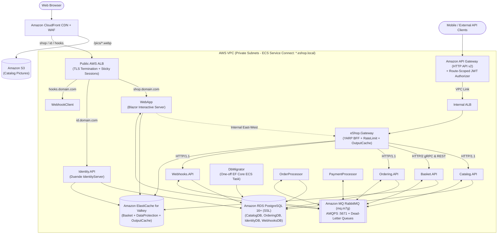

# eShop AWS Cloud Migration & Production-Readiness Plan

## 1. Executive Summary & Target Architecture

This plan defines the end-to-end refactoring, optimization, and migration strategy to take the **.NET 10 eShop** microservices solution from a local development sample to a **production-grade cloud architecture on Amazon Web Services (AWS)** while retaining **.NET Aspire (`eShop.AppHost`)** for local development.

### Core Architectural Decisions

1. **Local Development vs. Cloud Production (Hybrid Parity):**
   * **Local Development:** Retain **.NET Aspire (`eShop.AppHost`)** (`aspire run` / `dotnet run --project src/eShop.AppHost`) for one-command orchestration, Aspire Dashboard telemetry, and local containers.
   * **Production Deployment:** Package services using multi-stage Alpine Dockerfiles (`linux/arm64` Graviton), push to **Amazon ECR**, and run on **Amazon ECS on AWS Fargate**.
2. **Dual-Layer API Gateway Architecture (Outer AWS API Gateway + Inner YARP BFF):**
   * **Outer Edge (`https://api.<domain>`):** **Amazon API Gateway (HTTP API v2)** provides serverless edge throttling and native JWT pre-validation on protected routes before traffic enters the VPC via **AWS VPC Link $\rightarrow$ Internal ALB**. *(Note: attach AWS WAF via CloudFront in front of API Gateway/ALB, since HTTP API v2 does not attach WAF directly).*
   * **Inner BFF / Gateway (`src/eShop.Gateway`):** A dedicated **.NET 10 YARP Reverse Proxy** service running on ECS Fargate (and in local Aspire) handles path/version transforms, Valkey/Redis-backed Output Caching, fine-grained Rate Limiting, and native HTTP/2 gRPC routing to `Basket.API`.
   * **Storefront & Identity Ingress (`https://shop.<domain>`, `https://id.<domain>`):** Routed via **Amazon CloudFront $\rightarrow$ Public AWS ALB** to support persistent Blazor Interactive Server WebSockets (`/_blazor`) with sticky sessions and OIDC browser flows.
3. **Database Migration Strategy (Centralized EF Core Migrations in `DbMigrator`):**
   * **No Runtime `MigrateAsync()` or Seeding inside API Containers:** Application containers (`Catalog.API`, `Ordering.API`, `Identity.API`, `Webhooks.API`) never execute DDL migrations or data seeders at startup. All runtime seeders and startup migration extensions (`CatalogContextSeed`, `UsersSeed`, `OrderingContextSeed`, `MigrateDbContextExtensions`) have been eliminated from API projects.
   * **Unified `src/DbMigrator` (EF Core):** A single console project (`src/DbMigrator`) centralizes all EF Core migrations and `*ModelSnapshot.cs` files for all 4 databases (`CatalogDB`, `IdentityDB`, `OrderingDB`, `WebhooksDB`) under `src/DbMigrator/Migrations/`, while each API service configures `MigrationsAssembly("DbMigrator")`. Initial/reference data is managed via immutable PostgreSQL SQL `SeedData` migrations (`migrationBuilder.Sql(...)` with `ON CONFLICT DO NOTHING` and sequence `setval`). It applies migrations via `context.Database.MigrateAsync()` (or `dotnet ef database update`), running locally in `.NET Aspire` (`db-migrator`) and in AWS CI/CD as a single one-off ECS Fargate task (`aws ecs run-task`) before rolling out application services.

---

### Target Architecture Mapping

| Component | Local Development (.NET Aspire) | Target Production AWS Architecture |
| :--- | :--- | :--- |
| **Compute & Orchestration** | Aspire AppHost (`eShop.AppHost`) | **Amazon ECS on AWS Fargate** (`ARM64` Graviton) |
| **Edge API Gateway** | YARP (`eShop.Gateway`) | **Amazon API Gateway (HTTP API v2)** + **VPC Link** $\rightarrow$ **Internal ALB** |
| **Internal BFF / Reverse Proxy** | `src/eShop.Gateway` (YARP) | **`eShop.Gateway` (YARP on ECS)** + Valkey/Redis Output Cache |
| **Web & OIDC Ingress** | Kestrel HTTPS | **Amazon CloudFront** (WAF + CDN) + **Public AWS ALB** (ACM TLS) |
| **Static Product Images** | Local disk (`Pics/*.webp`) via YARP forwarder | **Amazon S3** + **Amazon CloudFront (OAC)** |
| **Relational Database** | Local `ankane/pgvector` container | **Amazon RDS for PostgreSQL 16+** (Single Multi-AZ instance, 4 DBs, `rds.force_ssl=1`, `pgvector` HNSW) |
| **Database Migrations** | `DbMigrator` (EF Core `MigrateAsync()` / `dotnet ef database update`) via Aspire | **Unified `DbMigrator` (EF Core)** One-off ECS Fargate Task in CI/CD |
| **Distributed Cache & Keys** | Local Redis container | **Amazon ElastiCache for Valkey** (Replication Group, Cluster Mode Disabled, Multi-AZ, TLS) |
| **Message Broker** | Local RabbitMQ container | **Amazon MQ for RabbitMQ (`mq.m7g`)** (AMQPS TLS `5671`, with DLX / Dead-Letter Queues) |
| **Internal Service Discovery** | Aspire Endpoint Discovery (`https+http://...`) | **AWS ECS Service Connect** (`*.eshop.local:8080`) |
| **Secrets & Signing Keys** | User Secrets / `appsettings.Development.json` | **AWS Secrets Manager** & **SSM Parameter Store** |
| **Observability** | Aspire Dashboard OTLP | **ADOT Collector Sidecar / OTLP**, **CloudWatch Logs / Application Signals**, **AWS X-Ray** |

---

### Target End-to-End Topology



---

## 2. Migration & Optimization Tasks Breakdown

### Phase 1: Centralized EF Core Migrations (`DbMigrator`) & Packaging

---

### Task 1: Disable EF Core Runtime Auto-Migration (`MigrateAsync`) & Eliminate Runtime Data Seeding in APIs

* **Issue:** Previously, `Catalog.API`, `Ordering.API`, `Identity.API`, and `Webhooks.API` invoked `builder.Services.AddMigration<TContext>()` in `src/Shared/MigrateDbContextExtensions.cs`, running `await context.Database.MigrateAsync()` and runtime data seeders (`CatalogContextSeed.cs`, `OrderingContextSeed.cs`, `UsersSeed.cs`) inside every API container on startup. Additionally, `UsersSeed.cs` unconditionally seeded demo accounts (`alice`, `bob`) with hardcoded password (`Pass123$`).
* **Impact:**
  1. Application containers require elevated DDL permissions (`CREATE`, `ALTER`, `DROP`) on production RDS databases, violating the principle of least privilege.
  2. Scaling out multiple ECS tasks simultaneously triggers concurrent migration race conditions and table locks.
  3. Demo credentials (`alice` / `Pass123$`) must not be deployed blindly into a production Identity database.
* **Status & Implemented Fix:**
  1. **[Done]** Removed `MigrateDbContextExtensions.cs`, `CatalogContextSeed.cs`, `OrderingContextSeed.cs`, `UsersSeed.cs`, and all startup auto-migration/seeding calls from API microservices.
  2. **[Done]** Retained EF Core `DbContext` entity configurations in API/Infrastructure projects and moved all migrations and `*ModelSnapshot.cs` files into `src/DbMigrator/Migrations/`.
  3. **[Done / Production Guard Needed]** Converted deleted runtime seeders into immutable PostgreSQL raw-SQL `SeedData` EF Core migrations (`migrationBuilder.Sql(...)` with `ON CONFLICT DO NOTHING` and identity `setval`) inside `DbMigrator`:
     * `Migrations/CatalogDb/*_SeedData.cs` (13 brands, 8 types, 101 catalog items)
     * `Migrations/OrderingDb/*_SeedData.cs` (`ordering.cardtypes`: Amex, Visa, MasterCard)
     * `Migrations/IdentityDb/*_SeedData.cs` (`alice` and `bob` demo accounts — **must be gated or replaced with non-demo bootstrap users before Production**; note: currently both `alice` and `bob` share the same UUID `'942a6802-0716-4295-957c-f2ccba8c2a06'`, causing `bob` to be skipped by `ON CONFLICT DO NOTHING`)

---

### Task 2: Build Unified `src/DbMigrator` Console Runner using EF Core

* **Issue:** Replacing API-startup migrations with standalone migrators per service would require maintaining 4 separate projects, 4 Dockerfiles, 4 ECR repositories, and 4 ECS Task Definitions.
* **Impact:** High operational and CI/CD maintenance overhead, slower deployment pipelines, and risk of drift between local development database setup and AWS production migrations.
* **Status & Implemented Fix:**
  1. **[Done]** Created consolidated console project `src/DbMigrator` (`<FrameworkReference Include="Microsoft.AspNetCore.App" />`) referencing `Npgsql.EntityFrameworkCore.PostgreSQL`, `Pgvector.EntityFrameworkCore`, `Microsoft.EntityFrameworkCore.Tools`, `Polly`, and project references to `Catalog.API`, `Identity.API`, `Ordering.Domain`, `Ordering.Infrastructure`, `Webhooks.API`, and `eShop.ServiceDefaults` (removing `dbup-postgresql`).
  2. **[Done]** Centralized EF Core migrations by target database under `src/DbMigrator/Migrations/`:
     * `Migrations/CatalogDb/` (`CatalogContext`: `Initial` + `SeedData`, including `vector` extension)
     * `Migrations/IdentityDb/` (`ApplicationDbContext`: `Initial` + `SeedData`)
     * `Migrations/OrderingDb/` (`OrderingContext`: `Initial` + `SeedData`)
     * `Migrations/WebhooksDb/` (`WebhooksContext`: `Initial`)
  3. **[Done]** Configured `MigrationsAssembly("DbMigrator")` on Npgsql `DbContextOptions` in `Catalog.API/Extensions/Extensions.cs`, `Identity.API/Program.cs`, `Ordering.API/Extensions/Extensions.cs`, and `Webhooks.API/Extensions/Extensions.cs`.
  4. **[Done]** Implemented `src/DbMigrator/Program.cs`:
     * Maps `DbContext` types to connection string keys via `dbContextMappings` (`Dictionary<Type, string>`).
     * Registers all 4 contexts via generic `RegisterDbContext<TContext>()` (requiring configured connection strings and throwing `InvalidOperationException` if missing).
     * Applies migrations via `await context.Database.MigrateAsync()` wrapped in Polly `WaitAndRetryAsync` (`5s`, `10s`, `20s`), logging each database name.
     * Supports both `dotnet run` (console/container) and `dotnet ef database update` CLI (documented in `src/DbMigrator/README.md` and `src/DbMigrator/script.txt`).
  5. **[Done]** Updated multi-stage Alpine `src/DbMigrator/Dockerfile` to `mcr.microsoft.com/dotnet/aspnet:10.0-alpine` (with `icu-libs` and `USER $APP_UID`), copying all referenced project files for layer-cached restore/publish.
  6. **[Partial]** Registered `db-migrator` (and `postgres-password` parameter) in `src/eShop.AppHost/AppHost.cs` waiting for all 4 databases. **Remaining:** Add `.WaitForCompletion(dbMigrator)` to downstream services (`identityApi`, `catalogApi`, `orderingApi`, `webHooksApi`) and update `order-processor`'s `.WaitFor(orderingApi)` dependency comment (since migrations now live in `DbMigrator`).

---

### Task 3: Add CI Guardrail Test for EF Core Model Snapshot Drift (`HasPendingModelChanges`)

* **Issue:** Because EF Core migrations now live in `src/DbMigrator/Migrations/` rather than inside each API assembly, developers might modify a C# Entity or `IEntityTypeConfiguration` without scaffolding a new migration in `DbMigrator`.
* **Impact:** Silent schema drift between C# entities and PostgreSQL tables, causing runtime `Npgsql.PostgresException` (missing column/table or type mismatch) only after deploying to Production.
* **Suggest Fix:**
  1. Enforce the developer workflow (documented in `src/DbMigrator/script.txt` and `src/DbMigrator/README.md`): whenever modifying an entity, run `dotnet ef migrations add <ChangeName> --project src/DbMigrator/DbMigrator.csproj --startup-project src/DbMigrator/DbMigrator.csproj --context <DbContext> --output-dir Migrations/<TargetDb>` and verify/apply with `dotnet ef database update`.
  2. Add an automated unit test (or CI step using `dotnet ef migrations has-pending-model-changes --no-build`) asserting `context.Database.HasPendingModelChanges() == false` for `CatalogContext`, `OrderingContext`, `ApplicationDbContext`, and `WebhooksContext`.

---

### Task 4: Optimize Multi-Stage Alpine Dockerfiles & Clean Up Workspace Artifacts

* **Issue:** Container builds need to target `linux/arm64` for AWS Fargate Graviton efficiency, an unused empty `deployments/` folder remains in the repository, and the newly added `src/eShop.Gateway/Dockerfile` uses `mcr.microsoft.com/dotnet/aspnet:10.0` (Debian) and runs `dotnet restore` **before** copying `Directory.Packages.props` (breaking Central Package Management builds).
* **Impact:** `eShop.Gateway` container builds fail under CPM; ~20% higher AWS Fargate compute costs if running `linux/amd64` instead of `linux/arm64` Graviton2/3.
* **Status & Suggest Fix:**
  1. **[Done]** Legacy empty directories (`src/Catalog.DbMigrator`, `src/Catalog.Infrastructure`, `deploy/docker`) are already absent; remove any remaining unused empty folders (e.g., `deployments/` if present).
  2. **[Done]** Multi-stage Alpine Dockerfiles (`mcr.microsoft.com/dotnet/aspnet:10.0-alpine` with `icu-libs` and non-root `USER $APP_UID`) are already present across all 10 original services (`Basket.API`, `Catalog.API`, `DbMigrator`, `Identity.API`, `Ordering.API`, `OrderProcessor`, `PaymentProcessor`, `WebApp`, `WebhookClient`, `Webhooks.API`).
  3. **[Pending]** Convert `src/eShop.Gateway/Dockerfile` to multi-stage `10.0-alpine` (`icu-libs` + `USER $APP_UID`), copy `Directory.*.props` / `nuget.config` / `eShop.ServiceDefaults.csproj` before `dotnet restore`, and configure Docker `buildx` in CI/CD to build `linux/arm64` images for AWS Fargate Graviton.

---

### Phase 2: Dual-Layer API Gateway Architecture (AWS API Gateway Edge + YARP Internal BFF)

---

### Task 5: Create & Harden Internal YARP BFF / Gateway Service (`src/eShop.Gateway`)

* **Issue:** `src/eShop.Gateway` was recently scaffolded (commit `c50d5cf`) with basic YARP routing (`Program.cs`, `appsettings.json` targeting `*.eshop.local:8080`), while `mobile-bff` in `src/eShop.AppHost/AppHost.cs` (lines 69–71) remains commented out and `WebApp/Program.cs` (line 32) still uses `Microsoft.Extensions.ServiceDiscovery.Yarp` solely to forward `/product-images/{id}`.
* **Impact:**
  1. `src/eShop.Gateway` does not yet reference `eShop.ServiceDefaults` (missing `/health`, `/alive`, OpenTelemetry, and Aspire Service Discovery).
  2. No centralized output caching or rate limiting protects RDS PostgreSQL and AI search routes.
* **Status & Suggest Fix:**
  1. **[Done]** Created `src/eShop.Gateway` (`Yarp.ReverseProxy`) with `appsettings.json` routes for `/api/catalog/{**catch-all}`, `/api/orders/{**catch-all}`, `/api/basket/{**catch-all}`, `/BasketApi.Basket/{**catch-all}` (HTTP/2), and `/api/webhooks/{**catch-all}`.
  2. **[Pending]** Reference `eShop.ServiceDefaults` in `eShop.Gateway` (`AddServiceDefaults()`, `AddServiceDiscovery()`, `MapDefaultEndpoints()`).
  3. **[Pending]** Add **ElastiCache Valkey/Redis-backed Output Caching** at `eShop.Gateway` for read-heavy catalog routes (`/api/catalog/items`, `/api/catalog/catalogbrands`, `/api/catalog/catalogtypes`, `/api/catalog/items/facets`) with a 15–60s TTL *(use Cluster-Mode Disabled Replication Group to avoid `CROSSSLOT` errors in Lua tag-eviction scripts)*.
  4. **[Pending]** Add **ASP.NET Core Rate Limiting** at `eShop.Gateway` for expensive endpoints (`/api/catalog/items/withsemanticrelevance` AI search and `POST /api/orders`), and wire `eShop.Gateway` into `src/eShop.AppHost/AppHost.cs`.

---

### Task 6: Enable HTTP/1.1 + HTTP/2 and gRPC JSON Transcoding on `Basket.API`

* **Issue:** `src/Basket.API/appsettings.json` (lines 8–12) forces `"Protocols": "Http2"` on Kestrel, and `Basket.API` only exposes a binary gRPC endpoint (`Basket.proto`).
* **Impact:**
  1. **ECS & ALB Health Check Failure:** Standard HTTP/1.1 health probes (`GET /health`, `GET /alive`) against `Basket.API` fail when Kestrel only accepts HTTP/2 cleartext (h2c), causing ECS/ALB health checks to kill the `Basket.API` container.
  2. **AWS API Gateway Incompatibility:** Amazon API Gateway (HTTP API v2) at the outer edge does not support binary gRPC passthrough, preventing external/REST clients from accessing the basket service through the edge gateway.
* **Suggest Fix:**
  1. Update `src/Basket.API/appsettings.json` to set `"Protocols": "Http1AndHttp2"` (Kestrel supports both HTTP/1.1 and `h2c` prior-knowledge HTTP/2 on cleartext port `8080`).
  2. Add `Microsoft.AspNetCore.Grpc.JsonTranscoding` to `src/Basket.API/Basket.API.csproj`, annotate `src/Basket.API/Proto/basket.proto` with `google.api.http` bindings (`GET /api/v1/basket`, `POST /api/v1/basket`, `DELETE /api/v1/basket`), and register `.AddGrpc().AddJsonTranscoding()`.
  3. Keep `WebApp` and internal YARP using HTTP/2 gRPC while enabling external REST JSON clients via `/api/basket/...` through API Gateway $\rightarrow$ `eShop.Gateway`.

---

### Task 7: Provision Amazon API Gateway (HTTP API v2) + VPC Link $\rightarrow$ Internal ALB $\rightarrow$ `eShop.Gateway`

* **Issue:** Exposing backend APIs or `eShop.Gateway` directly to the public internet bypasses AWS edge throttling and JWT validation. Furthermore, **ECS Service Connect (`*.eshop.local`) is an internal East-West Envoy mesh and cannot be targeted directly by an API Gateway VPC Link**, and attaching a JWT Authorizer globally would break public catalog reads (`GET /api/catalog/items`).
* **Impact:** Unauthenticated traffic hits ECS tasks directly, VPC Link misconfiguration causes `503`/`500` routing failures, and global JWT auth breaks anonymous storefront browsing.
* **Suggest Fix:**
  1. Provision **Amazon API Gateway (HTTP API v2)** mapped to `https://api.<domain>` (fronted by **CloudFront + AWS WAF**, since HTTP API v2 does not attach WAF directly).
  2. Place an **Internal ALB** (with `/alive` health check) in front of `eShop.Gateway`, and connect **API Gateway VPC Link** to that Internal ALB *(or alternatively register classic ECS Service Discovery `serviceRegistries` in AWS Cloud Map)*.
  3. **Split Public vs. Protected API Gateway Routes:**
     * Keep `GET /api/catalog/{proxy+}` **unauthenticated** (no JWT Authorizer) for public catalog browsing & facets.
     * Attach the **HTTP API v2 JWT Authorizer** (`iss = https://id.<domain>`, matching `aud` / scopes from Duende IdentityServer) to protected routes (`POST/PUT/DELETE /api/catalog/{proxy+}`, `ANY /api/orders/{proxy+}`, `ANY /api/basket/{proxy+}`, `ANY /api/webhooks/{proxy+}`).
  4. Keep `WebApp` (`https://shop.<domain>`) and `Identity.API` (`https://id.<domain>`) routed via **CloudFront $\rightarrow$ Public ALB** so Blazor Interactive Server WebSockets and OIDC redirects work natively, while `WebApp` calls internal services directly via ECS Service Connect (`*.eshop.local:8080`).

---

### Phase 3: Critical Application Code Refactoring (Production Showstoppers)

---

### Task 8: Enable `/health` and `/alive` Health Check Endpoints in Production

* **Issue:** In `src/eShop.ServiceDefaults/Extensions.cs` (lines 115–125), `app.MapHealthChecks("/health")` and `app.MapHealthChecks("/alive")` are guarded by `if (app.Environment.IsDevelopment())`.
* **Impact:** In AWS ECS Production (`ASPNETCORE_ENVIRONMENT=Production`), both `/health` and `/alive` return `404 Not Found`. AWS ALB Target Groups and ECS Container Health Checks fail 100% of probes and endlessly terminate and restart all containers.
* **Suggest Fix:**
  1. Remove the `if (app.Environment.IsDevelopment())` wrapper around `/health` and `/alive` in `src/eShop.ServiceDefaults/Extensions.cs`.
  2. Configure `.AllowAnonymous()` and `.DisableHttpMetrics()` on the health check endpoints.
  3. On the Public ALB, configure Target Group health checks to use `/alive` (liveness) or `/health` (readiness) and add an ALB Listener rule blocking external public internet requests to `/health`.

---

### Task 9: Configure `ForwardedHeadersMiddleware` for AWS ALB TLS Termination

* **Issue:** `builder.AddForwardedHeaders()` in `src/eShop.AppHost/AppHost.cs` only injects `ASPNETCORE_FORWARDEDHEADERS_ENABLED=true` when launched by Aspire. Even when enabled in ECS, ASP.NET Core's default `ForwardedHeadersOptions` only trusts `127.0.0.1` and ignores `X-Forwarded-Proto: https` and `X-Forwarded-For` sent by AWS ALB private subnet IPs.
* **Impact:**
  1. `WebApp` (`app.UseHttpsRedirection()` in `src/WebApp/Program.cs` line 26) sees incoming ALB requests as plain `http` and triggers an infinite redirect loop (`ERR_TOO_MANY_REDIRECTS`).
  2. `Identity.API` advertises `http://` endpoints in `/.well-known/openid-configuration`, breaking OIDC login redirects (`Invalid redirect_uri`) and browser cookie policies (`SameSite` / `Secure`).
* **Suggest Fix:**
  1. In `src/eShop.ServiceDefaults/Extensions.cs`, register `ForwardedHeadersOptions` with `ForwardedHeaders.XForwardedFor | ForwardedHeaders.XForwardedProto | ForwardedHeaders.XForwardedHost` and clear `KnownNetworks` and `KnownProxies` (safe because ECS tasks run in private subnets restricted by Security Groups to ALB traffic only).
  2. Ensure `app.UseForwardedHeaders()` runs at the very beginning of the middleware pipeline in `WebApp`, `Identity.API`, `WebhookClient`, and `eShop.Gateway`.
  3. When terminating TLS at **CloudFront** in front of an HTTP ALB origin, ensure CloudFront passes `X-Forwarded-Proto: https` (via Origin Custom Header) and forwards `Host` / `Origin` / cookies so ASP.NET Core issues `Secure` OIDC cookies properly.

---

### Task 10: Fix Split-Horizon DNS for OIDC / JWT Authentication (`Identity.API` Public Issuer vs. Internal Backchannel)

* **Issue:** Users authenticate via browser against the public `Identity.API` URL (`https://id.<domain>`), so tokens have `iss = https://id.<domain>`. However, internal services (`Basket.API`, `Ordering.API`, `Webhooks.API`, `WebApp`) configured with ECS Service Connect (`Identity__Url = http://identity-api.eshop.local:8080`) set `options.Authority = identityUrl` and `ValidIssuers = [identityUrl]` in `src/eShop.ServiceDefaults/AuthenticationExtensions.cs` (lines 38–47). Furthermore, `options.IssuerUri` in `src/Identity.API/Program.cs` (line 18) is commented out.
* **Impact:** All authenticated API requests fail with `401 Unauthorized` (`IDX10205: Issuer validation failed`) because the JWT `iss` claim (`https://id.<domain>`) does not match the internal Service Connect address (`http://identity-api.eshop.local:8080`).
* **Suggest Fix:**
  1. In `src/Identity.API/Program.cs`, set `options.IssuerUri = builder.Configuration["Identity:IssuerUri"]` when configured so IdentityServer always stamps the public HTTPS issuer URI regardless of internal/external request host.
  2. In `src/eShop.ServiceDefaults/AuthenticationExtensions.cs` and `src/WebApp/Extensions/Extensions.cs`, support `Identity:IssuerUri` (public URL `https://id.<domain>`) for `ValidIssuers` while allowing `Identity:Url` (`http://identity-api.eshop.local:8080`) to be used as the backchannel `Authority` / `MetadataAddress` for fast internal JWKS discovery.
  3. Change `options.TokenValidationParameters.ValidateAudience = false` (line 49 of `AuthenticationExtensions.cs`) to `true` for proper scope/audience isolation.

---

### Task 11: Persist ASP.NET Core Data Protection Keys & IdentityServer Signing Credentials

* **Issue:**
  1. `src/Identity.API/Program.cs` (lines 27 & 35) sets `options.KeyManagement.Enabled = false` and calls `.AddDeveloperSigningCredential()`, which generates an ephemeral `tempkey.jwk` file inside the container filesystem.
  2. `WebApp`, `Identity.API`, and `WebhookClient` do not configure shared ASP.NET Core Data Protection key storage.
* **Impact:** Running $\ge 2$ ECS tasks for high availability or deploying a new container revision immediately invalidates all issued JWTs, OIDC session cookies, Antiforgery tokens, and Blazor Server states (`CryptographicException: The key {...} was not found in the key ring`).
* **Suggest Fix:**
  1. Add `Microsoft.AspNetCore.DataProtection.StackExchangeRedis` and configure `.AddDataProtection().SetApplicationName("eShop").PersistKeysToStackExchangeRedis(...)` backed by **Amazon ElastiCache for Valkey** (or Redis OSS) with TLS (`ssl=true`) and AUTH/RBAC in `WebApp`, `Identity.API`, and `WebhookClient`.
  2. In `Identity.API/Program.cs`, use `.AddDeveloperSigningCredential()` only when `builder.Environment.IsDevelopment()`. In Production, load a persistent X.509 signing certificate from **AWS Secrets Manager** (or enable Duende Key Management persisted in `identitydb`), and exclude `tempkey.jwk` from production publish outputs.

---

### Task 12: Fix `WebApp` Blazor Server Real-Time Order Status Notifications Across Multiple ECS Tasks

* **Issue:** `WebApp` uses `OrderStatusNotificationService` (`src/WebApp/Services/OrderStatus/OrderStatusNotificationService.cs`) which stores active user UI callbacks in an **in-memory `Dictionary`** local to each container instance. At the same time, `src/EventBusRabbitMQ/RabbitMQEventBus.cs` (line 258) binds all instances of `WebApp` to a single shared RabbitMQ queue (`SubscriptionClientName = "WebApp"`).
* **Impact:** When `WebApp` runs $\ge 2$ ECS tasks, RabbitMQ distributes `OrderStatusChanged` events round-robin across instances. If User A's Blazor SignalR connection is on Task 1, but Task 2 consumes the RabbitMQ event, Task 2 finds no local subscriber in memory and acks the message—User A never receives real-time order status updates.
* **Suggest Fix:**
  1. Enable **Application-based Sticky Sessions** on the AWS ALB Target Group for `WebApp` so Blazor Server SignalR circuits remain pinned to the same ECS task.
  2. Update `RabbitMQEventBus` (or `EventBusOptions` in `WebApp`) to support an **instance-unique, auto-delete fanout queue** for `WebApp` (e.g., `WebApp-{Environment.MachineName}` with `exclusive: true, autoDelete: true`) so every running `WebApp` task receives order status change events and notifies its locally connected Blazor circuits.

---

### Task 13: Offload Product Images to Amazon S3 + CloudFront in `WebApp` (`ProductImageUrlProvider`)

* **Issue:** `Catalog.API` stores only filenames (`1.webp`) in PostgreSQL, while `src/WebApp/Services/ProductImageUrlProvider.cs` constructs relative URLs (`product-images/{productId}?api-version=2.0`) that `src/WebApp/Program.cs` (line 32) proxies through Kestrel to `Catalog.API` (`Pics/*.webp` on container disk).
* **Impact:** Every product image view on the storefront traverses `ALB -> WebApp -> Catalog.API -> Container Disk`, consuming Fargate CPU, memory, and internal bandwidth instead of being served at the CDN edge.
* **Suggest Fix:**
  1. Update `src/WebApp/Services/ProductImageUrlProvider.cs` to read an optional `ProductImagesBaseUrl` configuration setting (e.g., `https://<cloudfront-domain>/pics`).
  2. When `ProductImagesBaseUrl` is configured (AWS Production), return `{ProductImagesBaseUrl}/{productId}.webp` directly; when empty (local `.NET Aspire`), keep returning `product-images/{productId}?api-version=2.0` so local development requires no AWS S3 dependency.
  3. Upload `src/Catalog.API/Pics/*.webp` to the private S3 bucket (`aws s3 sync src/Catalog.API/Pics/ s3://<bucket>/pics/`) fronted by CloudFront Origin Access Control (OAC).

---

### Phase 4: Security Hardening, Messaging Reliability & AI Vector Optimization

---

### Task 14: Secure Unprotected Write Endpoints in `Catalog.API` & Externalize Hardcoded OIDC Secrets

* **Issue:**
  1. In `src/Catalog.API/Apis/CatalogApi.cs` (lines 100–117), mutating endpoints (`PUT /items`, `PUT /items/{id}`, `POST /items`, `DELETE /items/{id}`) lack `.RequireAuthorization()`.
  2. `src/Identity.API/Configuration/Config.cs`, `src/WebApp/Extensions/Extensions.cs`, and `src/WebhookClient/Extensions/Extensions.cs` hardcode OAuth `ClientSecret = "secret"`.
  3. `src/Identity.API/Services/RedirectService.cs` extracts `redirect_uri` using brittle `Regex.Split` string manipulation.
* **Impact:** Unauthenticated callers can modify product prices or delete the entire catalog; attackers can use the hardcoded `"secret"` to impersonate confidential OIDC clients; regex URL parsing risks open-redirect vulnerabilities.
* **Suggest Fix:**
  1. Call `builder.AddDefaultAuthentication()` in `Catalog.API`, add the `"Identity"` config section (`Audience: "catalog"`) to `Catalog.API/appsettings.json`, register `"catalog"` as an `ApiScope`/`ApiResource` (and add to client `AllowedScopes`) in `src/Identity.API/Configuration/Config.cs`, and chain `.RequireAuthorization()` on `POST`, `PUT`, and `DELETE` endpoints in `CatalogApi.cs`.
  2. Load OIDC client secrets (`WebAppClientSecret`, `WebhooksClientSecret`, `MauiClientSecret`) from `IConfiguration` backed by **AWS Secrets Manager** (falling back to `"secret"` only in `Development`).
  3. Replace manual regex splitting in `RedirectService.cs` with `Uri.TryCreate` and `QueryHelpers.ParseQuery` (or Duende's `IIdentityServerInteractionService`).

---

### Task 15: Fix Silent Message Loss (DLQ) & Graceful Shutdown in `RabbitMQEventBus` + Outbox Recovery

* **Issue:**
  1. In `src/EventBusRabbitMQ/RabbitMQEventBus.cs` (lines 170–180), `OnMessageReceived` catches all exceptions and still calls `await _consumerChannel.BasicAckAsync(...)`, permanently deleting failed messages from RabbitMQ.
  2. `StartAsync` (line 229) fires an unawaited `Task.Factory.StartNew(async () => ...)` and `StopAsync` (line 297) is empty (`return Task.CompletedTask;`).
  3. `IntegrationEventLogEF` marks failed event publishes as `PublishedFailed`, but no background worker ever retries stuck `NotPublished` or `PublishedFailed` records.
* **Impact:** Transient database timeouts or deadlocks during order/payment processing cause permanent event loss (orders stuck in `Submitted` or `AwaitingValidation` forever); ECS task termination (`SIGTERM`) drops in-flight messages.
* **Suggest Fix:**
  1. In `RabbitMQEventBus.cs` (which currently declares `ExchangeName = "eshop_event_bus"` as `type: "direct"`), declare a Dead-Letter Exchange (`eshop_event_bus_dlx`) and Dead-Letter Queue (`{_queueName}_dlq`) via queue arguments (`x-dead-letter-exchange`). On handler exception after retry, call `BasicNackAsync(eventArgs.DeliveryTag, multiple: false, requeue: false)` so poison messages are routed to DLQ for inspection and CloudWatch alarming. Ensure connection strings use `amqps://` over port `5671` (Amazon MQ requires TLS).
  2. Implement `StopAsync` in `RabbitMQEventBus.cs` to gracefully close `_consumerChannel` and `_rabbitMQConnection` when ECS sends `SIGTERM`.
  3. Add a background recovery worker (`OutboxRetryBackgroundService`) in `Catalog.API` and `Ordering.API` that polls `IntegrationEventLog` for `NotPublished` / `PublishedFailed` entries older than 30 seconds and republishes them.

---

### Task 16: Align AI Vector Embeddings (`pgvector`) with Amazon Bedrock / OpenAI in Production

* **Issue:** `src/Catalog.API/Services/CatalogAI.cs` (line 9) hardcodes `private const int EmbeddingDimensions = 384;` to match the initial PostgreSQL schema `Embedding vector(384)`.
* **Impact:** Configuring Amazon Bedrock (`amazon.titan-embed-text-v2:0`, which supports 256, 512, or 1024 dimensions) without matching dimensions causes runtime vector dimension mismatch exceptions in PostgreSQL; missing vector indexes cause slow sequential scans as catalog size grows.
* **Suggest Fix:**
  1. Make `EmbeddingDimensions` configurable via `CatalogOptions` (defaulting to `384` to work out-of-the-box with local Ollama `all-minilm`, OpenAI `text-embedding-3-small` with `Dimensions = 384`, or Amazon Bedrock `cohere.embed-english-light-v3`).
  2. Add an EF Core migration in `src/DbMigrator/Migrations/CatalogDb/` (e.g., `AddHnswVectorIndex` via `CatalogItemEntityTypeConfiguration` or `migrationBuilder.Sql(...)`) to create the HNSW vector index:
     ```sql
     CREATE INDEX IF NOT EXISTS ix_catalog_embedding_hnsw
     ON "Catalog" USING hnsw ("Embedding" vector_cosine_ops);
     ```

---

### Phase 5: AWS Infrastructure (IaC), CI/CD Pipeline & Production Observability

---

### Task 17: Provision Cost-Optimized AWS Foundation Infrastructure via IaC (Terraform / CDK)

* **Issue:** Provisioning 4 separate RDS instances or routing all ECR image pulls, S3 accesses, and CloudWatch logs through NAT Gateways creates unnecessary AWS infrastructure costs.
* **Impact:** Monthly AWS bill increases by 300%+ due to redundant RDS instances and NAT Gateway per-GB data processing charges.
* **Suggest Fix:**
  1. **VPC & Endpoints:** Provision a 2-AZ VPC (2 Public Subnets, 2 Private Subnets) with a free **VPC Gateway Endpoint for S3** and VPC Interface Endpoints for `ecr.api`, `ecr.dkr`, `logs`, and `secretsmanager` *(in production high-volume traffic; note that for low-traffic dev/lab clusters, 1 NAT Gateway can be cheaper than multiple multi-AZ interface endpoints)*.
  2. **Consolidated RDS PostgreSQL:** Provision **1 Multi-AZ Amazon RDS for PostgreSQL 16+** instance in private subnets (`rds.force_ssl = 1` default $\rightarrow$ require `SSL Mode=Require` in connection strings) hosting all 4 logical databases (`CatalogDB`, `OrderingDB`, `IdentityDB`, `WebhooksDB`). Pre-create the 4 databases and `CREATE EXTENSION IF NOT EXISTS vector;` in `CatalogDB` (or grant `CREATEDB` and `rds_extension` specifically to the `DbMigrator` role), while giving each API service a separate least-privilege DML-only DB user.
  3. **ElastiCache & Amazon MQ:** Provision **Amazon ElastiCache for Valkey** (Replication Group, **Cluster Mode Disabled**, Multi-AZ with Automatic Failover, Transit Encryption `rediss://` + RBAC AUTH — avoiding `CROSSSLOT` errors in ASP.NET Output Caching) and **Amazon MQ for RabbitMQ (`mq.m7g` family, AMQPS port `5671` only; note `mq.t3.micro` reached EOS Oct 1, 2026)** in private subnets, storing connection strings in **AWS Secrets Manager**.

---

### Task 18: Configure ECS Fargate Cluster, Service Connect (`eshop.local`), ALB & API Gateway Routing

* **Issue:** Microservices require reliable East-West service discovery (supporting both HTTP/1.1 REST and HTTP/2 gRPC) while North-South traffic is split between browser apps (`WebApp`, `Identity.API`) and API consumers (`eShop.Gateway`). Note also that API Gateway VPC Link cannot target ECS Service Connect directly.
* **Impact:** Misconfigured protocols, missing Internal ALB / Cloud Map `serviceRegistries`, or missing `curl` in Alpine containers break internal gRPC calls, API Gateway routing, or container health checks.
* **Suggest Fix:**
  1. Create an **Amazon ECS Cluster** (Fargate `ARM64` capacity provider) with **ECS Service Connect** enabled under namespace `eshop.local`.
  2. Register internal Service Connect endpoints with named Task Definition ports (`catalog-api.eshop.local:8080` [`http`], `basket-api.eshop.local:8080` [`grpc` or `http2`], `ordering-api.eshop.local:8080` [`http`], `identity-api.eshop.local:8080` [`http`], `webhooks-api.eshop.local:8080` [`http`], `eshop-gateway.eshop.local:8080` [`http`]).
  3. Deploy `OrderProcessor` and `PaymentProcessor` as background ECS Services (`WebApplication` listening on `:8080/alive`) with no public ingress; if configuring ECS container `healthCheck`, use `wget` (if present) or install `curl` in their Dockerfiles (Alpine `aspnet:10.0-alpine` omits `curl` by default).
  4. Configure **1 Public ALB** behind CloudFront with Host-based routing (`shop.<domain>` $\rightarrow$ `WebApp` with Sticky Sessions, `id.<domain>` $\rightarrow$ `Identity.API`, `hooks.<domain>` $\rightarrow$ `WebhookClient`), and place **1 Internal ALB** in front of `eShop.Gateway` targeted by **Amazon API Gateway (HTTP API v2)** (`api.<domain>`) via **VPC Link**.

---

### Task 19: Build GitHub Actions CI/CD Pipeline with Single `DbMigrator` ECS Gate

* **Issue:** Deploying updated API containers before running database migrations causes runtime SQL errors; running migrations inside API startup causes race conditions.
* **Impact:** Failed deployments or downtime during schema upgrades.
* **Suggest Fix:**
  1. **Build & Test Stage:** Run `dotnet test` (including the EF Model Snapshot drift check from `Task 3`), build `linux/arm64` Alpine Docker images, and push to Amazon ECR.
  2. **Database Migration Gate:** Execute a single one-off ECS Fargate task for `eshop-db-migrator` (which executes EF Core `MigrateAsync()` across all 4 databases):
     ```bash
     aws ecs run-task \
       --cluster eshop-cluster \
       --task-definition eshop-db-migrator \
       --launch-type FARGATE \
       --network-configuration "awsvpcConfiguration={subnets=[...],securityGroups=[...],assignPublicIp=DISABLED}"
     ```
     Wait for task completion (`aws ecs wait tasks-stopped`) and verify exit code `0`. Abort pipeline immediately if non-zero.
  3. **Rolling Deployment Stage:** Trigger rolling updates for ECS services (`Catalog.API`, `Basket.API`, `Ordering.API`, `Identity.API`, `Webhooks.API`, `eShop.Gateway`, `WebApp`, `OrderProcessor`, `PaymentProcessor`).

---

### Task 20: Configure Production OpenTelemetry Sampling, CloudWatch Logs & Alarms

* **Issue:** `src/eShop.ServiceDefaults/Extensions.cs` (lines 68–78) configures `AlwaysOnSampler()` in development, lacks EF Core trace instrumentation, and has no production sampling ratio configured when `OTEL_EXPORTER_OTLP_ENDPOINT` is enabled.
* **Impact:** High CloudWatch Logs and AWS X-Ray ingestion bills under production traffic, and missing SQL query spans when troubleshooting latency.
* **Suggest Fix:**
  1. In `src/eShop.ServiceDefaults/Extensions.cs`, configure `ParentBasedSampler(new TraceIdRatioBasedSampler(0.1))` (10% trace sampling) when `!builder.Environment.IsDevelopment()`.
  2. Run an **AWS Distro for OpenTelemetry (ADOT) Collector** sidecar (or CloudWatch Agent / OTLP ingestion) in ECS Task Definitions exporting traces to **AWS X-Ray / CloudWatch Application Signals**, and configure `awslogs` on all ECS Task Definitions with a **14-to-30-day retention policy**.
  3. Provision CloudWatch Alarms for:
     * Public ALB, Internal ALB & API Gateway HTTP `5xx` rate > 1%
     * ECS Service CPU / Memory utilization > 80%
     * RDS PostgreSQL CPU > 80% and FreeableMemory < 20%
     * Amazon MQ Dead-Letter Queue (`*_dlq`) message count > 0

---

## 3. Implementation Tracking Checklist

- [ ] **Phase 1: Centralized EF Core Migrations (`DbMigrator`) & Packaging**
  - [x] Task 1: Disable EF Core runtime `MigrateAsync()` & eliminate runtime seeders from APIs *(note: guard/remove `alice`/`bob` demo seed in `IdentityDb` `SeedData` and fix duplicate UUID before Production)*
  - [x] Task 2: Build unified `src/DbMigrator` with centralized EF Core migrations (`Initial` + SQL `SeedData`), `Dockerfile`, `README.md`/`script.txt`, and `AppHost` registration *(follow-up: wire `.WaitForCompletion(dbMigrator)` on API services in `AppHost.cs`)*
  - [ ] Task 3: Add CI guardrail test (`HasPendingModelChanges() == false`)
  - [ ] Task 4: Fix `src/eShop.Gateway/Dockerfile` (convert to `10.0-alpine` + copy `Directory.*.props` before restore), clean up empty folders, and configure `linux/arm64` CI builds *(10 original service Alpine Dockerfiles completed)*
- [ ] **Phase 2: Dual-Layer API Gateway (AWS API Gateway + YARP BFF)**
  - [ ] Task 5: Harden `src/eShop.Gateway` (`eShop.ServiceDefaults`, Valkey/Redis OutputCache, RateLimiter, wire into `AppHost.cs`; initial YARP scaffold committed in `c50d5cf`)
  - [ ] Task 6: Enable `Http1AndHttp2` & gRPC JSON Transcoding on `Basket.API`
  - [ ] Task 7: Define Amazon API Gateway (HTTP API v2) + Route-Scoped JWT Auth + VPC Link $\rightarrow$ Internal ALB $\rightarrow$ `eShop.Gateway`
- [ ] **Phase 3: Critical Application Code Fixes (Production Showstoppers)**
  - [ ] Task 8: Enable `/health` and `/alive` endpoints in Production
  - [ ] Task 9: Configure `ForwardedHeadersMiddleware` for AWS ALB / CloudFront
  - [ ] Task 10: Fix Split-Horizon DNS (`IssuerUri` vs. internal `Authority`) in `Identity.API` & clients
  - [ ] Task 11: Persist Data Protection keys to ElastiCache Valkey/Redis & Identity signing certs to Secrets Manager
  - [ ] Task 12: Fix `WebApp` Blazor Server real-time notifications across multiple ECS tasks
  - [ ] Task 13: Update `ProductImageUrlProvider` in `WebApp` for S3 + CloudFront URLs
- [ ] **Phase 4: Security Hardening, Messaging Reliability & AI Vector Optimization**
  - [ ] Task 14: Add `.RequireAuthorization()` + `"Identity"` config to `Catalog.API`, register `"catalog"` scope in `Identity.API`, & externalize OIDC secrets
  - [ ] Task 15: Add Dead-Letter Queue (DLQ), graceful shutdown, and Outbox retry worker
  - [ ] Task 16: Make `EmbeddingDimensions` configurable & add HNSW index migration in `DbMigrator/Migrations/CatalogDb`
- [ ] **Phase 5: AWS Infrastructure (IaC), CI/CD & Observability**
  - [ ] Task 17: Provision VPC (with S3/ECR endpoints), consolidated RDS (`pgvector`, `rds.force_ssl=1`, least-privilege DB roles), ElastiCache Valkey, Amazon MQ (`mq.m7g`, AMQPS `5671`)
  - [ ] Task 18: Configure ECS Fargate Cluster (`ARM64`), Service Connect (`eshop.local`), CloudFront + Public ALB, Internal ALB & API Gateway
  - [ ] Task 19: Create GitHub Actions CI/CD workflow with `eshop-db-migrator` ECS task gate
  - [ ] Task 20: Configure Production OTel sampling (10%), ADOT sidecar, CloudWatch Log retention, and DLQ/5xx Alarms
